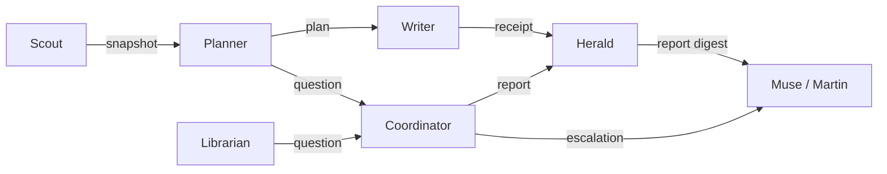

# Bot definitions

Canonical, generator-ready definitions for the six personal-loop role bots. Each
bot lives in its own directory with `profile.json` (machine-readable) and
`INSTRUCTIONS.md` (runtime instructions projected from dotai by the future
generator). These files are **ours** — not Hermes-native formats.

## Bot summary

| Role | Consumes | Produces | Model tier | Schedule |
|------|----------|----------|------------|----------|
| scout | — | snapshot | cheap | interval (`30m`) |
| planner | snapshot | plan, question | strong | event (`artifact:snapshot`) |
| writer | plan | receipt | cheap | event (`artifact:plan`) |
| herald | receipt, report | report | cheap | cron (`0 7,19 * * *`) |
| librarian | snapshot, receipt | question | strong | cron (`0 5 * * *`) |
| coordinator | question | report | cheap | interval (`5m`) |

## Artifact flow



Happy path handoffs are **peer-to-peer artifacts** (Scout → Planner → Writer).
Questions and human decisions flow through **Coordinator** → Muse. **Herald**
renders batched digests from Receipts and folds in health Reports; urgent items
are flagged in the Report for immediate delivery via Muse. **Librarian** mines Snapshots and Receipts over time and
proposes brain changes as Questions only.

Consultation uses `consult-request` / `consult-response` artifacts (see
`protocol/README.md`) and is declared per bot in `profile.json` → `consult`.

## Generator consumption

A later build step will read each `bots/<role>/profile.json` plus dotai sources
to emit Hermes profile distributions: identity, tool allowlists (enforced again
at personal-mcp), schedules, budgets, and injected instructions from
`INSTRUCTIONS.md`. The validator in this directory guards shape and policy
before generation.

## Validation

From the repository root:

```bash
python3 bots/validate.py
```

Exit code `0` means all structural and policy checks passed.
